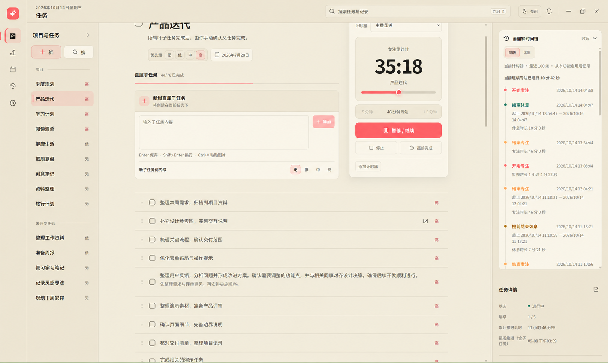

<p align="center">
  
</p>

<p align="center">
  <a href="#开始使用">下载安装</a> ·
  <a href="#功能亮点">功能亮点</a> ·
  <a href="#使用指南">使用指南</a> ·
  <a href="#源码运行">源码运行</a>
</p>

<p align="center">
  <a href="https://github.com/quecai-niu/Taskato/releases/latest"></a>
  
  
  <a href="#许可证"></a>
</p>

<p align="center">一个安静的 Windows 本地工作台，把任务拆分、番茄专注和每日复盘连在一起。</p>

<p align="center">
  
</p>

<p align="center"><sub>日间工作区 · 项目与任务内容已替换为展示用示例</sub></p>

## 开始使用

下载 Taskato，开始有节奏地推进每一天。

<table>
  <tr>
    <td align="center" width="50%">
      <h3><a href="https://github.com/quecai-niu/Taskato/releases/download/v2.75/Taskato-2.75.0-win-x64-setup.exe">下载 Windows 安装包</a></h3>
      <p>安装后使用，支持开始菜单与桌面快捷方式。</p>
    </td>
    <td align="center" width="50%">
      <h3><a href="https://github.com/quecai-niu/Taskato/releases/download/v2.75/Taskato-2.75.0-win-x64-portable.zip">下载便携版 ZIP</a></h3>
      <p>解压到可写目录，运行 Taskato.exe。</p>
    </td>
  </tr>
</table>

<p align="center"><sub>Windows 10 / 11 · .NET 8 自包含 · 无需单独安装 .NET Desktop Runtime</sub></p>

安装包会在缺少 WebView2 Evergreen Runtime 时从微软官方入口下载；便携版需要电脑已安装该运行时。发布包不含个人任务、数据库或设置；覆盖升级前，建议在“设置 → 数据与维护”创建备份。

## 功能亮点

<table>
  <tr>
    <td width="33%" valign="top">
      <h3>拆分任务</h3>
      <p>最多五层任务，把大目标拆成可执行步骤；支持优先级、拖拽排序和图片附件。</p>
    </td>
    <td width="33%" valign="top">
      <h3>进入专注</h3>
      <p>番茄计时与任务相连，支持暂停、休息和剩余时长调整；重启后恢复计时状态。</p>
    </td>
    <td width="33%" valign="top">
      <h3>回看进展</h3>
      <p>通过时间链、专注统计与每日总结回顾投入，也可以手动记录每一次推进。</p>
    </td>
  </tr>
</table>

## 最新发布

**[v2.75 · 2026-10-14](https://github.com/quecai-niu/Taskato/releases/tag/v2.75)**

- 新任务和直属子任务输入框支持粘贴图片，显示待保存缩略图，可移除或重试未保存的附件。
- 任务树与子任务列表显示附图小图标，点击即可查看该任务的图片。
- 图片预览支持“上一张 / 下一张”和键盘左右方向键。
- 此版本也包含任务排序、任务栏折叠、时间链与连续专注累计、专注目标恢复等主线更新。

本次发布已通过前端构建、.NET Release 自包含发布和安装包编译；未执行额外测试或人工界面验收。完整变更与发布清单见 [GitHub Release](https://github.com/quecai-niu/Taskato/releases/tag/v2.75)。

## 使用指南

1. **理清任务**：点击左侧“新”，输入任务内容；在详情中继续添加直属子任务。
2. **补充资料**：在输入框按 `Ctrl+V` 粘贴截图，创建任务时保存附图；通过任务行的图片图标查看附件。
3. **开始专注**：选中任务并启动番茄钟，需要时暂停、休息或调整剩余时间。
4. **记录推进**：在任务详情点击“记录推进”，写下成果并填写实际投入时长。
5. **回看一天**：在“专注统计”“每日总结”和“历史记录”中回顾时间与进展。

<details>
<summary><strong>展开完整功能说明</strong></summary>

| 模块 | 能力 |
| --- | --- |
| 今日任务 | 只展示未完成、今天发布或今天完成的任务，并保留必要的父级路径；支持筛选、一键展开/收起和页面切换后恢复选中项 |
| 层级任务 | 最多 5 层嵌套、任务组与未归类分区、同优先级任务拖拽排序、直属子任务编辑、父任务迁移、删除分支或提升直属子任务；右击左栏任务或详情中的子任务行可选择“删除”，通过居中且跟随日间/夜间主题的应用内弹窗确认后，删除该任务及全部子任务，完成历史保留；取消或按 Esc 可关闭确认窗 |
| 完成规则 | 子任务全部完成后父任务仍保持未完成，由用户手动确认大任务或阶段任务完成；新增未完成子任务会重新打开相关父级 |
| 任务内容 | 第一行统一作为界面标题，其余行作为详细说明；详情编辑停止输入后自动保存，失去焦点立即保存，保存请求按顺序执行；切换任务再返回时保留尚未保存成功的草稿，更新内容原样保留首尾空格与换行；详情页的子任务行展示完整说明并自动换行，新增任务和子任务时可选择四级优先级 |
| 专注目标 | 在直属子任务的右键菜单中选择“设为专注目标”或“取消专注目标”，可同时标记多个，计时器只在原有任务名称行显示目标数量；单击和点击空白处不改变标记，切换任务组时清空；标记在页面切换及重启后保留，重启时恢复其所属任务；取消全部标记后恢复默认启动选中规则；计时和完成记录统一归属当前任务组，避免重复统计 |
| 番茄钟 | 主番茄钟与多个附加计时器、工作/休息循环、暂停、停止和提前完成；运行中可拖动进度条按分钟调整剩余时间，上限为阶段满时长的 1.5 倍 |
| 跨进程计时 | 使用绝对截止时间持久化；关闭软件不影响倒计时，重新打开时自动恢复，已超时则显示过去多久并弹出提醒 |
| 番茄钟时间链 | 右侧栏顶部默认展开，占用原番茄钟区域，默认简略模式；可切换简略和详细。简略仅显示最近 100 条记录中的六种彩色事件：开始专注、开始休息、结束专注、结束休息、提前结束休息、提前结束专注；第二行小字显示暂停时长或本轮专注、休息时长（扣除暂停）；开始前暂停短于设置阈值的已结束轮次合并开始、结束，显示起止时间；多轮已结束专注之间没有休息且没有保留的开始节点时，合并为一条“结束专注”，时间取最后结束时间，时长累加各轮实际专注时长；达到暂停阈值、正在进行的新一轮保留开始事件，缺少配对开始或时长的旧记录不合并；隐藏暂停、恢复、提醒、选择及任务内容。详细展示全部事件；结束或暂停显示本轮累计进行了多久（扣除暂停），开始显示上一阶段结束后暂停了多久，恢复显示本次暂停时长；其他事件显示事件间隔，记录重启后保留，无对应计时数据时不推算 |
| 专注统计 | 按天、周、月查看半小时或自然日热力格子、工作启动标记、专注/休息/暂停/总时长、启动次数、最长单次和活跃天数 |
| 统计口径 | 有效总时长包含番茄钟专注、休息和暂停区间；暂停进入热力图与活跃天数但不计入最长单次，完成弹窗等待不计入 |
| 提醒与飞书 | 工作完成、休息完成、休息过半和手动测试分别配置发送次数；可选择提示时是否直接打开软件界面 |
| 每日总结 | 展示当天完成成果、番茄钟有效总时长（专注、休息与暂停）与手动推进记录；推进内容、所属任务和时长可直接修正 |
| 历史记录 | 只追加保存创建、编辑、移动、完成、取消完成和删除事件；支持日期、关键词筛选及 CSV 导出 |
| 数据安全 | 本地 SQLite、设置与运行状态备份，恢复前完整性校验、恢复回滚副本和本地诊断日志 |
| 系统集成 | 托盘常驻、休眠恢复、最小化后台运行、开机自启、单例运行及窗口状态持久化 |

</details>

<details>
<summary><strong>展开任务、图片与番茄钟操作细节</strong></summary>

任务详情支持多张图片附件：在任务内容下方点击“添加图片”可多选文件，也可在任务内容输入框或图片附件区域按 Ctrl+V 粘贴截图。支持 PNG、JPEG、GIF、BMP、WebP，每张最多 10 MB、4000 万像素。新任务和直属子任务的输入框也支持 Ctrl+V 粘贴图片，输入框下方会显示待保存缩略图，可移除；创建任务时一起保存附图。任务树和子任务列表中，有附图的任务会显示图片图标；点击图标或附件缩略图查看原图，通过“上一张 / 下一张”或键盘左右箭头切换该任务的图片，按 Esc 或点击“关闭”退出；图片可单独删除。图片保存到任务数据库，随数据备份和恢复；删除任务时同步清理附件，保留的子任务附件不受影响。

1. 在左栏新增任务并选择优先级；需要拆分时，在任务详情顶部继续添加直属子任务。
2. 用任务树的一键展开/收起和筛选快速定位当前分支；通过拖拽手柄或长按任务行调整同级、同优先级任务的顺序，双击子任务进入详情编辑。“项目与任务”栏顶部支持折叠和展开：折叠后显示约 170px 宽的名称清单、并排的“新”“搜”按钮和“无／低／中／高”优先级，长名称以省略号显示，精简样式仅作用于左栏，悬停任务可查看完整名称，点击“搜”展开并定位搜索框。重启后保留折叠状态，展开时恢复原栏宽（窗口缩小时按可用空间调整）。任务页上半区左侧显示标题、说明、元信息和缩窄的新增子任务卡片，右侧沿用原番茄钟控件；下方子任务列表保持全宽。新增子任务支持多行内容：Enter 保存、Shift+Enter 换行，中文输入法选字时 Enter 不保存；输入框固定为 96px 高度，超出内容内部滚动；优先级说明在左侧，选项紧凑排列在右侧。窄正文区域改为上下排列，避免挤压控件。
3. 完成叶子任务后，由你决定何时手动确认父任务或整个任务组完成。
4. 选择当前任务并启动番茄钟；运行中可拖动倒计时进度条调整专注或休息剩余时间，软件关闭、系统休眠或界面卡顿不会让计时变慢。
5. 番茄钟自然结束或提前完成后保存本次专注时长，不自动新增推进记录；右侧“番茄钟时间链”默认展开，顶部实时显示当前连续专注或休息已进行的时长（扣除暂停和等待选择的时间）；选择“继续工作”或自动开始下一轮专注时累加之前连续轮次，进入休息或主动停止后重新累计，累计读取完整会话记录，不受最近 100 条显示上限影响。暂停时保留累计时长并标记“已暂停”，恢复后继续累计；调整剩余时间不改变已累计时长，阶段结束后由历史记录展示。可查看专注和休息的开始、结束时间，切换“详细”可回看提醒与选择记录。简略和详细模式默认隐藏不足 1 分钟的暂停时长文字；简略模式将开始前暂停短于阈值的已结束轮次合为结束记录，显示起止时间与实际时长，连续多轮专注之间没有休息且没有保留的开始节点时继续合并累计时长；达到阈值的暂停、尚未结束的轮次，以及缺少配对开始或时长的旧记录保留原样。详细模式保留全部事件，原始统计不受影响。在“设置 → 番茄钟时长 → 时间链暂停忽略阈值（分钟）”中可设置 0–60 的整数分钟，保存后生效，0 表示全部显示且不合并开始节点，等于阈值时仍显示。
6. 需要记录进展时，在任务详情点击“记录推进”；新增记录默认归属当前详情任务，也可取消归属或选择其他任务。
7. 在任务详情查看本任务的推进时间线，父任务可切换查看包含子任务的全部推进。
8. 在“专注统计”中切换天、周、月，查看哪些时间启动过专注以及专注、休息、暂停时长。
9. 在“每日总结”回看成果与推进，并可修正推进所属和时长；在“历史记录”查询完整活动时间线。
10. 如需远程提醒，在设置中配置飞书 Webhook 和四类通知次数。

</details>

## 源码运行

<details>
<summary><strong>环境要求、构建运行与发布命令</strong></summary>

### 环境要求

- Windows 10/11
- [.NET 8 SDK](https://dotnet.microsoft.com/download/dotnet/8.0)
- Node.js 20 或更高版本
- Microsoft Edge WebView2 Runtime（Windows 11 通常已包含）

### 克隆、构建与运行

```powershell
git clone https://github.com/quecai-niu/Taskato.git
cd Taskato
cd src/Taskato.Web
npm ci
npm run build
cd ../..
dotnet run --project src/Taskato/Taskato.csproj
```

### 测试

```powershell
cd src/Taskato.Web
npm ci
npm run check
npm test
npm run build
cd ../..
dotnet build Taskato.sln -c Release
dotnet run --project src/TestProject/TestProject.csproj -c Release
```

### 生成发布包

完整发布脚本会执行前端测试、C# 回归与真实 WebView2 烟测，再生成便携包：

```powershell
.\scripts\build-release.ps1 -Version 2.75.0
```

已安装 Inno Setup 时，同时生成安装包：

```powershell
.\scripts\build-release.ps1 -Version 2.75.0 -BuildInstaller
```

完整运行时、升级、签名和回滚策略见 [发布与恢复说明](docs/release_Taskato_20260729.md)。

</details>

<details>
<summary><strong>技术栈、项目结构与本地数据</strong></summary>

| 层级 | 技术 |
| --- | --- |
| 桌面宿主 | WPF、WebView2、Windows Forms NotifyIcon |
| Web UI | React 19、TypeScript、Vite、Phosphor Icons |
| 业务与桥接 | .NET 8、C#、Service/ViewModel、JSON WebBridge 白名单协议 |
| 数据 | SQLite、sqlite-net-pcl、事务化任务活动日志、推进记录和番茄钟会话区间 |
| 通知 | 原生提醒窗口、MediaPlayer/SoundPlayer、飞书 Webhook |
| 验证 | Vitest、TestProject、Release WebView2 自动烟测 |

## 项目结构

```text
Taskato/
├─ src/
│  ├─ Taskato/
│  │  ├─ Assets/          # 图标与原生资源
│  │  ├─ Models/          # 任务、活动、专注统计与 Bridge DTO
│  │  ├─ Services/        # SQLite、计时器、设置、桥接、托盘、通知与备份
│  │  ├─ ViewModels/      # 任务工作区、番茄钟和每日总结状态
│  │  └─ Views/           # WebView2 主壳层与原生短流程窗口
│  ├─ Taskato.Web/        # React 工作区、Bridge client、browser mock 与测试
│  └─ TestProject/        # C# 回归与集成测试
├─ installer/             # Inno Setup 安装定义
├─ scripts/               # 发布、WebView2 与窗口烟测脚本
├─ docs/                  # 设计、发布、审查与项目导航文档
├─ Taskato.sln
└─ README.md
```

## 配置与数据

应用默认在程序目录下的 `Data` 中维护本地数据：

- `Data/taskato.db`：任务树、完成记录、推进记录、只追加活动日志和番茄钟专注区间。
- `Data/settings.json`：主题、窗口、番茄钟、提示音、通知和系统偏好。
- `Data/pomodoro-state.json`：跨进程恢复所需的计时状态。

WebView2 浏览器缓存默认放在 `%LOCALAPPDATA%/Taskato/WebView2`，不会进入程序目录、备份文件或发布包。Taskato 不需要云端账号，除非你主动配置飞书 Webhook，否则业务数据不会发送到外部服务。

</details>

## 许可证

Taskato 采用 [PolyForm Noncommercial License 1.0.0](LICENSE)，以源码可用方式发布，不属于 OSI 定义的开源软件。

- 允许将本软件用于个人学习、研究、实验、测试、业余项目及许可证列明的其他非商业用途。
- 允许在非商业用途范围内修改和分发本软件；分发时必须同时提供许可证条款及规定的通知。
- 不允许将本软件用于商业目的。商业使用或商业授权请事先联系著作权人并取得书面许可。

除文件另有说明外，本许可证适用于本仓库中著作权由许可方拥有的全部 Taskato 源代码，包括历史版本与历史提交；不适用于第三方依赖、第三方资源或许可方无权许可的内容。

本节仅作通俗说明，不替代 `LICENSE` 中的完整条款；两者不一致时，以 `LICENSE` 为准。

---

<p align="center">专注，让生活更从容。<br /><a href="https://github.com/quecai-niu/Taskato/issues">反馈问题</a> · <a href="https://github.com/quecai-niu/Taskato/releases/latest">查看最新发布</a></p>
