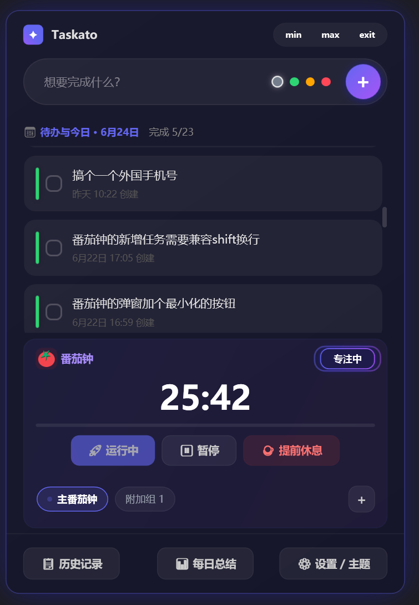

# Taskato

<p align="center">
  
</p>

<h3 align="center">把番茄钟、今日任务、历史复盘放在一个安静好看的 Windows 桌面应用里</h3>

<p align="center">
  <a href="#快速开始">快速开始</a>
  ·
  <a href="#功能亮点">功能亮点</a>
  ·
  <a href="#界面预览">界面预览</a>
  ·
  <a href="#项目结构">项目结构</a>
</p>

<p align="center">
  <a href="https://github.com/quecai-niu/Taskato/commits/master"></a>
  <a href="https://github.com/quecai-niu/Taskato/stargazers"></a>
  <a href="https://github.com/quecai-niu/Taskato/issues"></a>
  <a href="https://github.com/quecai-niu/Taskato"></a>
</p>

---

## 这是什么

Taskato 是一个基于 **.NET 8 + WPF + WebView2 + React** 的番茄钟与任务管理桌面应用。WPF 负责窗口、托盘、通知和本地服务，React 负责完整工作区界面。

主界面采用可缩放、可最大化的整窗工作区，通过左侧导航在任务、每日总结、历史记录和设置之间切换；任务页按任务树、当前任务和番茄钟分栏展示。

- 专注前，把今天要做的事放进任务列表。
- 专注中，用番茄钟保持节奏，支持多组并行计时。
- 专注后，通过提醒弹窗、提示音、飞书通知把状态拉回来。
- 一天结束，用每日总结和历史查询回看完成情况。

## 界面预览

<p align="center">
  
</p>

更多交互预览：

- [React 整窗工作区设计基准](docs/previews/preview_TaskatoWorkspace_20260728_1421/index.html)
- [番茄钟附加组删除按钮预览](docs/previews/preview_PomodoroTabDelete_20260618_1407.html)
- [番茄钟完成弹窗鎏金边框预览](docs/previews/preview_ToastGoldBorder_20260618_1406.html)
- [番茄钟完成弹窗熔金闪卡预览](docs/previews/preview_ToastGoldHybrid_20260618_1411.html)

## 功能亮点

| 模块 | 能力 |
| --- | --- |
| 番茄钟 | 工作/休息循环、暂停、跳过、提前休息、实时进度条、状态动画 |
| 多组计时 | 主番茄钟 + 附加番茄钟，选项卡切换，附加组支持删除 |
| 任务管理 | 最多 5 层子任务、树形展开、父级进度、级联完成、4 级优先级、任务笔记、全局搜索与完成耗时 |
| 提醒弹窗 | 四角轮换出现、鎏金边框、按钮延迟启用、显示已出现时长 |
| 提示音 | 无声、Windows Notify、Ding、Background、Chimes、自定义音效 |
| 飞书通知 | 工作完成、休息完成、休息过半、重复提醒均可配置 |
| 每日总结 | 按顶级任务分组、叶子/父级成果统计、有效完成过滤、复制/导出、补充任务 |
| 历史查询 | 只追加的创建/编辑/移动/完成/取消完成/删除日志、日期与关键词筛选、CSV 导出 |
| 数据安全 | 数据与设置备份、恢复前完整性校验、恢复回滚副本、本地崩溃诊断日志 |
| 系统集成 | 托盘常驻、休眠恢复计时、最小化后台运行、开机自启、单例运行 |

## 快速开始

### 环境要求

- Windows 10/11
- [.NET 8 SDK](https://dotnet.microsoft.com/download/dotnet/8.0)
- Node.js 20 或更高版本（仅源码构建前端时需要）
- Microsoft Edge WebView2 Runtime（Windows 11 通常已包含）

### 克隆与运行

```powershell
git clone https://github.com/quecai-niu/Taskato.git
cd Taskato
cd src/Taskato.Web
npm ci
npm run build
cd ../..
dotnet run --project src/Taskato/Taskato.csproj
```

### 构建

```powershell
cd src/Taskato.Web
npm ci
npm test
npm run build
cd ../..
dotnet build Taskato.sln -c Release
```

Release 构建会检查 `src/Taskato.Web/dist/index.html`；缺失时会给出明确错误，避免生成只能显示空白页的安装包。前端开发时可启动 Vite，并把 `TASKATO_WEB_DEV_URL` 设置为开发服务器地址。

生成经过完整检查的便携发布包：

```powershell
.\scripts\build-release.ps1 -Version 2.22.0
```

运行时、安装包、升级和回滚策略见 [发布与恢复说明](docs/release_Taskato_20260729.md)。

## 使用方式

1. 在主界面添加今日任务，可用 `#标签` 做轻量分类，也可在任务卡片中快速添加直属子任务。
2. 展开任务树逐项完成叶子任务；全部子任务完成后，父任务会自动完成并记录为阶段成果。
3. 双击任务进入详情，可更换父任务、管理直属子任务或调整层级。
4. 设置工作/休息时长，启动番茄钟。
5. 使用左侧导航进入历史记录或每日总结，按大任务分组回看仍然有效的叶子任务和父级成果。
6. 如需远程提醒，在设置中配置飞书 Webhook。

## 技术栈

| 层级 | 技术 |
| --- | --- |
| UI | React 19、TypeScript、Vite、WebView2；WPF 保留原生宿主与短流程弹窗 |
| 架构 | C# Service / ViewModel 为唯一业务事实来源，JSON WebBridge 白名单通信 |
| 运行时 | .NET 8, C# |
| 存储 | SQLite, sqlite-net-pcl |
| 系统集成 | Windows Forms NotifyIcon, HKCU Run |
| 通知 | ToastWindow, MediaPlayer/SoundPlayer, Feishu Webhook |

## 项目结构

```text
Taskato/
├─ src/
│  ├─ Taskato/
│  │  ├─ Assets/          # 图标与图片资源
│  │  ├─ Converters/      # XAML 值转换器
│  │  ├─ Models/          # 任务等数据模型
│  │  ├─ Services/        # 数据库、计时器、设置、托盘、飞书通知
│  │  ├─ Utils/           # RelayCommand、视觉效果等工具
│  │  ├─ ViewModels/      # Main、Pomodoro、History、DailySummary
│  │  └─ Views/           # WebView2 主壳层、旧 WPF 回退页与原生短流程弹窗
│  ├─ Taskato.Web/        # React + TypeScript 工作区、桥接客户端与浏览器 mock
│  └─ TestProject/
├─ docs/
│  └─ previews/           # UI 预览与截图
├─ Taskato.sln
└─ README.md
```

## 配置与数据

应用会在运行目录下维护本地数据与设置：

- `Data/settings.json`：主题、番茄钟、提示音、通知等偏好设置。
- SQLite 数据库：保存任务树及独立完成记录；取消完成不会删除历史，但每日总结只展示当前仍有效的最后一次完成；已删除任务仍可保留完成快照。

这些数据默认留在本机，不需要云端账号。

## 当前版本

`v2.18`

- 主工作区迁移为 React + TypeScript，并由 WPF WebView2 承载。
- 新增最多五层的任务树、独立子任务输入、父级级联成果与有效每日总结。
- 新增创建、完成和取消完成事件时间线，同时保留旧 WPF 工作区回退入口。
- 完整桥接番茄钟、托盘窗口操作、设置、系统文件选择和原生完成弹窗。
