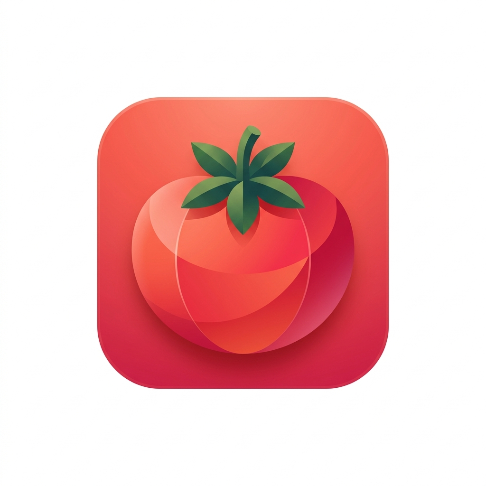
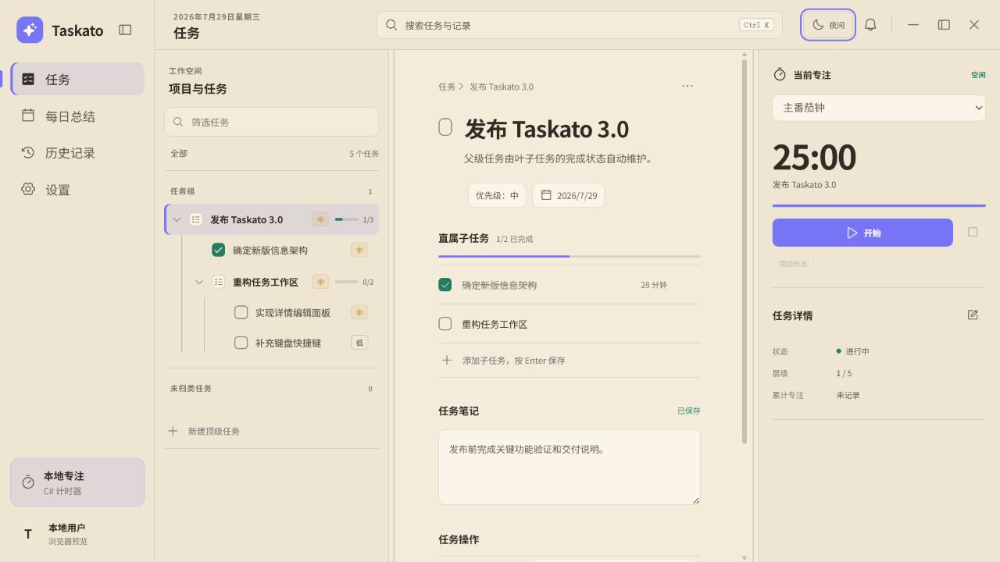

# Taskato

<p align="center">
  
</p>

<h3 align="center">把层级任务、番茄专注、时间统计和每日复盘放进一个安静的 Windows 工作台</h3>

<p align="center">
  <a href="#下载安装">下载安装</a>
  ·
  <a href="#功能亮点">功能亮点</a>
  ·
  <a href="#界面预览">界面预览</a>
  ·
  <a href="#源码运行">源码运行</a>
  ·
  <a href="#许可证">许可证</a>
</p>

<p align="center">
  <a href="https://github.com/quecai-niu/Taskato/releases/latest"></a>
  <a href="https://github.com/quecai-niu/Taskato/commits/master"></a>
  <a href="https://github.com/quecai-niu/Taskato/stargazers"></a>
  <a href="https://github.com/quecai-niu/Taskato/issues"></a>
</p>

---

## 这是什么

Taskato 是一个基于 **.NET 8 + WPF + WebView2 + React** 的 Windows 本地任务与番茄钟应用。

- React 提供任务、专注统计、每日总结、历史记录和设置五个完整业务页面。
- C# 负责 SQLite 数据、任务规则、番茄钟、托盘、通知、备份恢复和系统生命周期。
- WPF 只保留 WebView2 桌面宿主、完成确认、提醒弹窗和必要的原生文件对话框，不再维护旧版 WPF 工作区。

主界面是可最大化、可缩放分栏的整窗工作台。日间模式采用低刺激米黄色，夜间模式采用高对比深色主题；左侧导航固定收起为图标栏，分栏宽度和最大化状态会在下次启动时恢复；窗口按钮按当前状态显示最大化或还原图标。

## 界面预览

<p align="center">
  
</p>

<p align="center"><sub>React 整窗工作区：层级任务树、任务详情与多组番茄钟</sub></p>

更多设计与验证资料：

- [React 整窗工作区设计基准](docs/previews/preview_TaskatoWorkspace_20260728_1421/index.html)
- [日间与夜间主题实现对比](docs/audits/review_TaskatoUiOption1_20260729_1336/comparison.png)
- [专注统计与旧版界面清理记录](docs/20260807_2144_plan_FocusAnalytics_专注统计与旧版界面清理.md)

## 功能亮点

| 模块 | 能力 |
| --- | --- |
| 今日任务 | 只展示未完成、今天发布或今天完成的任务，并保留必要的父级路径；支持筛选、一键展开/收起和页面切换后恢复选中项 |
| 层级任务 | 最多 5 层嵌套、任务组与未归类分区、同优先级任务拖拽排序、直属子任务编辑、父任务迁移、删除分支或提升直属子任务 |
| 完成规则 | 子任务全部完成后父任务仍保持未完成，由用户手动确认大任务或阶段任务完成；新增未完成子任务会重新打开相关父级 |
| 任务内容 | 第一行统一作为界面标题，其余行作为详细说明；详情页的子任务行展示完整说明并自动换行，新增任务和子任务时可选择四级优先级 |
| 番茄钟 | 主番茄钟与多个附加计时器、工作/休息循环、暂停、停止和提前完成；运行中可拖动进度条按分钟调整剩余时间，上限为阶段满时长的 1.5 倍 |
| 跨进程计时 | 使用绝对截止时间持久化；关闭软件不影响倒计时，重新打开时自动恢复，已超时则显示过去多久并弹出提醒 |
| 番茄钟时间链 | 番茄钟与任务详情之间默认折叠，默认简略模式；可切换简略和详细。简略仅显示最近 100 条记录中的专注、休息开始与结束时间（含停止、提前完成和自然到期），隐藏暂停、恢复、提醒、选择、任务内容与时长。详细展示全部事件；结束或暂停显示本轮累计进行了多久（扣除暂停），开始显示上一阶段结束后暂停了多久，恢复显示本次暂停时长；其他事件显示事件间隔，记录重启后保留，无对应计时数据时不推算 |
| 专注统计 | 按天、周、月查看半小时或自然日热力格子、工作启动标记、专注/休息/暂停/总时长、启动次数、最长单次和活跃天数 |
| 统计口径 | 有效总时长包含番茄钟专注、休息和暂停区间；暂停进入热力图与活跃天数但不计入最长单次，完成弹窗等待不计入 |
| 提醒与飞书 | 工作完成、休息完成、休息过半和手动测试分别配置发送次数；可选择提示时是否直接打开软件界面 |
| 每日总结 | 展示当天完成成果、番茄钟有效总时长（专注、休息与暂停）与手动推进记录；推进内容、所属任务和时长可直接修正 |
| 历史记录 | 只追加保存创建、编辑、移动、完成、取消完成和删除事件；支持日期、关键词筛选及 CSV 导出 |
| 数据安全 | 本地 SQLite、设置与运行状态备份，恢复前完整性校验、恢复回滚副本和本地诊断日志 |
| 系统集成 | 托盘常驻、休眠恢复、最小化后台运行、开机自启、单例运行及窗口状态持久化 |

## 下载安装

最新稳定版是 **v2.40**：

- [下载 Windows 安装包](https://github.com/quecai-niu/Taskato/releases/download/v2.40/Taskato-2.40.0-win-x64-setup.exe)
- [下载便携版 ZIP](https://github.com/quecai-niu/Taskato/releases/download/v2.40/Taskato-2.40.0-win-x64-portable.zip)
- [查看 v2.40 Release、SHA-256 与发布清单](https://github.com/quecai-niu/Taskato/releases/tag/v2.40)

安装包是 `.NET 8 win-x64` 自包含版本，目标电脑不需要预装 .NET Desktop Runtime；若系统缺少 WebView2 Evergreen Runtime，安装器会从微软官方入口下载。

发布包不包含任何个人任务、数据库或设置。程序首次运行后才会创建自己的 `Data` 目录；覆盖升级同一安装目录时不会覆盖已有数据，但升级前仍建议在“设置 → 数据与维护”中创建备份。

## 使用方式

任务详情支持多张图片附件：在任务内容下方点击“添加图片”可多选文件，也可在任务内容输入框或图片附件区域按 Ctrl+V 粘贴截图。支持 PNG、JPEG、GIF、BMP、WebP，每张最多 10 MB、4000 万像素。点击缩略图查看原图，按 Esc 或点击“关闭”退出；图片可单独删除。图片保存到任务数据库，随数据备份和恢复；删除任务时同步清理附件，保留的子任务附件不受影响。

1. 在左栏新增任务并选择优先级；需要拆分时，在任务详情顶部继续添加直属子任务。
2. 用任务树的一键展开/收起和筛选快速定位当前分支；通过拖拽手柄或长按任务行调整同级、同优先级任务的顺序，双击子任务进入详情编辑。“项目与任务”栏顶部支持折叠和展开：折叠后显示“新”“搜”、任务名称首字和优先级，悬停任务可查看完整名称，点击“搜”展开并定位搜索框。重启后保留折叠状态，展开时恢复原栏宽（窗口缩小时按可用空间调整）。
3. 完成叶子任务后，由你决定何时手动确认父任务或整个任务组完成。
4. 选择当前任务并启动番茄钟；运行中可拖动倒计时进度条调整专注或休息剩余时间，软件关闭、系统休眠或界面卡顿不会让计时变慢。
5. 番茄钟自然结束或提前完成后保存本次专注时长，不自动新增推进记录；展开右侧“番茄钟时间链”默认查看专注和休息的开始、结束时间，切换“详细”可回看提醒与选择记录。
6. 需要记录进展时，在任务详情点击“记录推进”；新增记录默认归属当前详情任务，也可取消归属或选择其他任务。
7. 在任务详情查看本任务的推进时间线，父任务可切换查看包含子任务的全部推进。
8. 在“专注统计”中切换天、周、月，查看哪些时间启动过专注以及专注、休息、暂停时长。
9. 在“每日总结”回看成果与推进，并可修正推进所属和时长；在“历史记录”查询完整活动时间线。
10. 如需远程提醒，在设置中配置飞书 Webhook 和四类通知次数。

## 源码运行

### 环境要求

- Windows 10/11
- [.NET 8 SDK](https://dotnet.microsoft.com/download/dotnet/8.0)
- Node.js 20 或更高版本
- Microsoft Edge WebView2 Runtime（Windows 11 通常已包含）

### 克隆、构建与运行

```powershell
git clone https://github.com/quecai-niu/Taskato.git
cd Taskato
cd src/Taskato.Web
npm ci
npm run build
cd ../..
dotnet run --project src/Taskato/Taskato.csproj
```

### 测试

```powershell
cd src/Taskato.Web
npm ci
npm run check
npm test
npm run build
cd ../..
dotnet build Taskato.sln -c Release
dotnet run --project src/TestProject/TestProject.csproj -c Release
```

### 生成发布包

生成经过前端测试、C# 回归和真实 WebView2 烟测的便携包：

```powershell
.\scripts\build-release.ps1 -Version 2.40.0
```

已安装 Inno Setup 时，同时生成安装包：

```powershell
.\scripts\build-release.ps1 -Version 2.40.0 -BuildInstaller
```

完整运行时、升级、签名和回滚策略见 [发布与恢复说明](docs/release_Taskato_20260729.md)。

## 许可证

Taskato 采用 [PolyForm Noncommercial License 1.0.0](LICENSE)，以源码可用方式发布，不属于 OSI 定义的开源软件。

- 允许将本软件用于个人学习、研究、实验、测试、业余项目及许可证列明的其他非商业用途。
- 允许在非商业用途范围内修改和分发本软件；分发时必须同时提供许可证条款及规定的通知。
- 不允许将本软件用于商业目的。商业使用或商业授权请事先联系著作权人并取得书面许可。

除文件另有说明外，本许可证适用于本仓库中著作权由许可方拥有的全部 Taskato 源代码，包括历史版本与历史提交；不适用于第三方依赖、第三方资源或许可方无权许可的内容。

本节仅作通俗说明，不替代 `LICENSE` 中的完整条款；两者不一致时，以 `LICENSE` 为准。

## 技术栈

| 层级 | 技术 |
| --- | --- |
| 桌面宿主 | WPF、WebView2、Windows Forms NotifyIcon |
| Web UI | React 19、TypeScript、Vite、Phosphor Icons |
| 业务与桥接 | .NET 8、C#、Service/ViewModel、JSON WebBridge 白名单协议 |
| 数据 | SQLite、sqlite-net-pcl、事务化任务活动日志、推进记录和番茄钟会话区间 |
| 通知 | 原生提醒窗口、MediaPlayer/SoundPlayer、飞书 Webhook |
| 验证 | Vitest、TestProject、Release WebView2 自动烟测 |

## 项目结构

```text
Taskato/
├─ src/
│  ├─ Taskato/
│  │  ├─ Assets/          # 图标与原生资源
│  │  ├─ Models/          # 任务、活动、专注统计与 Bridge DTO
│  │  ├─ Services/        # SQLite、计时器、设置、桥接、托盘、通知与备份
│  │  ├─ ViewModels/      # 任务工作区、番茄钟和每日总结状态
│  │  └─ Views/           # WebView2 主壳层与原生短流程窗口
│  ├─ Taskato.Web/        # React 工作区、Bridge client、browser mock 与测试
│  └─ TestProject/        # C# 回归与集成测试
├─ installer/             # Inno Setup 安装定义
├─ scripts/               # 发布、WebView2 与窗口烟测脚本
├─ docs/                  # 设计、发布、审查与项目导航文档
├─ Taskato.sln
└─ README.md
```

## 配置与数据

应用默认在程序目录下的 `Data` 中维护本地数据：

- `Data/taskato.db`：任务树、完成记录、推进记录、只追加活动日志和番茄钟专注区间。
- `Data/settings.json`：主题、窗口、番茄钟、提示音、通知和系统偏好。
- `Data/pomodoro-state.json`：跨进程恢复所需的计时状态。

WebView2 浏览器缓存默认放在 `%LOCALAPPDATA%/Taskato/WebView2`，不会进入程序目录、备份文件或发布包。Taskato 不需要云端账号，除非你主动配置飞书 Webhook，否则业务数据不会发送到外部服务。

## 当前版本

`v2.28`

- 天、周、月专注统计分别展示专注、休息与暂停时长，暂停计入有效总时长，完成等待仍排除。
- 任务树支持最多五层、手动确认父级成果、当前任务筛选、折叠状态和会话选中项保持。
- 番茄钟支持运行中拖动调整专注/休息剩余时间、跨进程恢复、超时提醒、多组计时和四类可配置飞书通知次数。
- WebView2 成为唯一工作区 UI，旧版 WPF 业务页面和回退入口已经移除。
- 提供经过前端、C# 和真实 WebView2 烟测的安装包、便携包、SHA-256 与发布清单。
