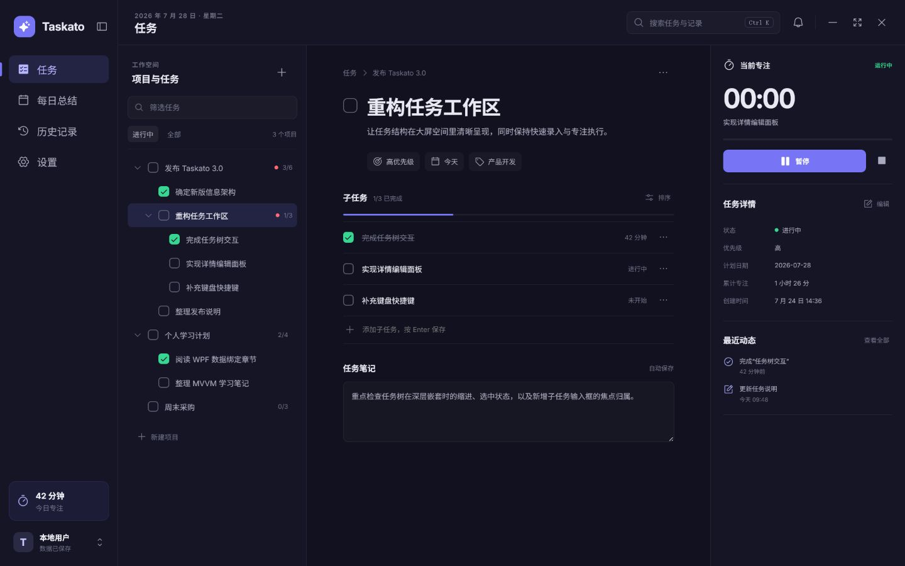
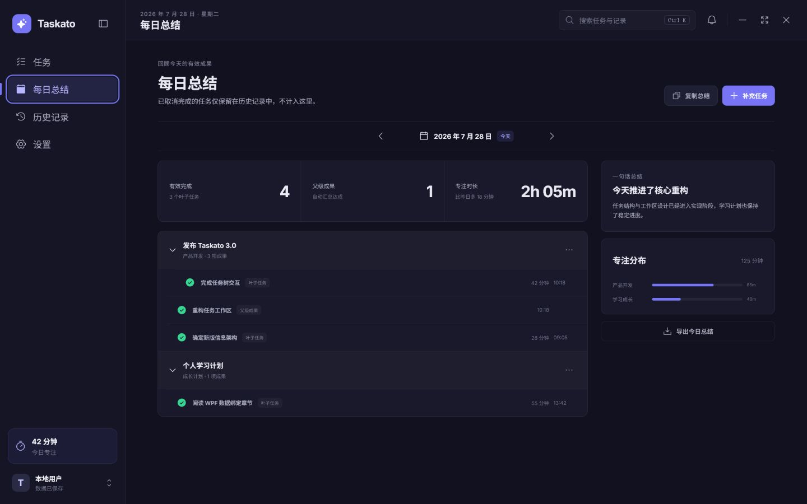
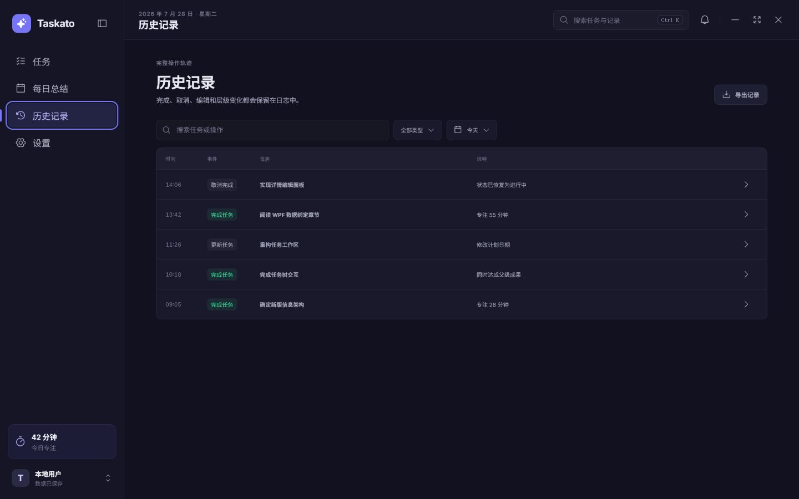
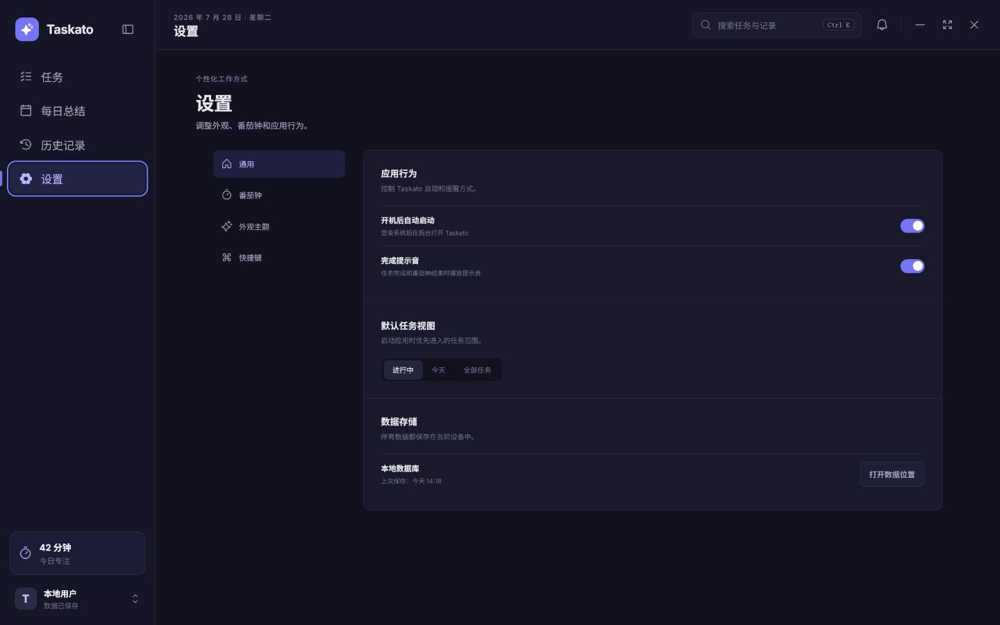

# Taskato 产品成熟度审计

审计时间：2026-07-28 19:41

## 总体判断

Taskato 当前属于“视觉完成度较高、核心链路已经接通的功能型 Beta”，还不是可以放心长期交付的成熟桌面软件。

- 个人自用 Beta 成熟度：约 60%。
- 面向普通用户发布的产品成熟度：约 45%。
- 与成熟软件的剩余差距：约 55%，主要不在换皮，而在交互闭环、真实操作日志、异常恢复、端到端测试和发布工程。

## 审计步骤

### 1. 任务工作区：基础健康，但存在“看起来能做、实际入口偏薄”的问题

- [x] 三栏结构、层级、选中态、完成进度和专注区清晰。
- [x] 主任务与子任务的视觉关系已经接近正常生产力软件。
- [x] “更多操作”已改为包含重命名、笔记、移动和删除入口的动作菜单。
- [x] 顶部“搜索任务与记录”已改为 `Ctrl+K` 统一命令面板，可跨任务标题、笔记与活动日志搜索。
- [x] 通知按钮已改为就地通知中心，并提供历史记录和提醒设置入口。
- [x] 任务笔记、自动保存状态、任务移动和删除操作已在实际 WebView2 工作区落地。

健康度：视觉 75%，交互闭环 50%。

### 2. 每日总结：信息组织良好，但纠错与解释能力不足

- [x] 有效完成、父级成果、专注时长和任务分组容易理解。
- [x] “补充任务”与导出入口明确。
- [x] 已补充叶子有效完成、父级成果和专注时长的统计口径说明，并允许从记录回到仍存在的任务。
- [x] 已补齐空状态、复制/导出进行状态、无补充候选以及冲突错误反馈。

健康度：展示 70%，异常与纠错闭环 40%。

### 3. 历史记录：页面像成品，但底层仍是投影而不是真正审计日志

- [x] 搜索、类型、日期和导出的骨架完整。
- [x] 后端已使用只追加 `TaskActivityRecords` 统一记录创建、编辑、移动、完成、取消完成和删除事件。
- [x] 取消完成使用事件发生时写入的独立时间，不再由 `LastModifiedAt` 推导。
- [x] 历史行可回到仍存在的任务；已删除任务使用快照并明确禁用跳转。

健康度：页面外观 70%，历史可信度 35%。

### 4. 设置：覆盖面广，但还需要真实桌面环境中的长期验证

- [x] 设置分区清楚，开关具有可访问名称与 pressed 状态。
- [x] 本地存储与原生能力的边界表达基本清楚。
- [x] 已统一保存中、已保存、保存失败、恢复上次保存值和旧工作区切换确认反馈。
- [x] 已在真实 Release WebView2 宿主验证启动、原生桥接、任务写入、全局搜索和关闭到托盘；流水线新增可重复 WebView2 自动烟测，休眠跨时通过可控时钟自动化测试。

健康度：配置覆盖 65%，桌面行为可信度 40%。

## 横向差距

| 维度 | 当前判断 | 成熟软件要求 |
| --- | ---: | --- |
| 视觉与布局 | 75% | 各页面、弹窗、空态、错误态和响应式保持一致 |
| 核心功能接线 | 65% | 所有高频任务形成连续、可撤销、可恢复的闭环 |
| 交互细节 | 45% | 搜索、菜单、编辑、反馈、撤销、键盘操作都可预测 |
| 数据可信度 | 50% | 真实事件日志、迁移、备份恢复和损坏处理可验证 |
| 测试与稳定性 | 35% | 组件、桥接、端到端、托盘、休眠、多屏和长时间运行覆盖 |
| 发布工程 | 25% | 安装、升级、签名、运行时策略、诊断与回滚闭环 |

## 最高优先级建议

1. 先补完任务主流程：统一搜索、真实动作菜单、详情编辑/笔记、保存状态、撤销和明确的错误恢复。
2. 把历史记录改成真正的追加式活动日志，停止用 `LastModifiedAt` 推导关键事件。
3. 拆分 1835 行的 `App.tsx` 和 750 行的 `WebBridgeService.cs`，让页面与桥接处理器可独立测试。
4. 增加 WebView2 端到端测试与真实桌面稳定性观察，特别是托盘、休眠恢复、通知和计时器。
5. 最后补发布工程：安装包、升级策略、WebView2 Runtime、备份恢复、崩溃诊断与回滚。

## 实施记录（2026-07-29）

### 已完成

- [x] 任务主流程：真实动作菜单、跨页全局搜索、任务笔记自动保存、保存状态、危险操作确认、常用操作撤销和统一错误重试。
- [x] 可信历史：新增只追加活动表；任务写操作与活动事件在同一 SQLite 事务内提交；旧数据仅幂等回填可证明的创建/完成事实，并写入迁移边界。
- [x] 职责拆分：`App.tsx` 仅保留应用级导航与错误边界，桌面框架、共享 UI 和四个可独立渲染的工作区页面迁出；`WebBridgeService` 按核心协议、总结/历史、设置/数据能力拆成 partial 文件。
- [x] 数据保护：备份 SQLite 与设置、归档清单校验、SQLite 完整性检查、下次启动前恢复、恢复前回滚副本。
- [x] 稳定与诊断：本地未处理异常日志、30 天日志清理、WebView2/Bridge 异常记录、绝对截止时间计时、休眠恢复同步、通知去重/释放，以及双屏与屏幕断开时的窗口归位。
- [x] 发布工程：2.21.0 自包含版本信息、便携包、Inno Setup 安装包、双份 SHA-256、发布清单、WebView2 Evergreen 策略和人工升级/回滚说明。
- [x] 自动化验证：C# 树与活动日志/迁移/备份/桥接/窗口归位/24 小时加速计时/通知生命周期测试，前端类型检查、10 项桥接与组件测试、Vite 生产构建。
- [x] 真实宿主烟测：人工验证任务写入、详情与笔记、`Ctrl+K` 搜索及关闭到托盘；发布流水线自动验证 Release WebView2、React 根节点、本地桥接和无错误状态。

### 实施调整

1. 原计划建议把前端页面拆成独立文件。首轮为降低迁移风险曾保留聚合页面模块；本轮完成四页面独立文件拆分，`WorkspacePages.tsx` 只提供稳定导出，页面内部紧密状态仍留在各自页面内。验证方式为 TypeScript 检查、页面独立渲染测试、生产构建和真实宿主烟测。
2. 旧版本没有普通编辑、移动和删除的可靠时间事实，因此迁移不伪造这些事件；只回填已有 `CreatedAt` 和完成记录，并插入“此前日志不完整”的迁移边界。验证方式为重复初始化后记录数量不增长。
3. 自动升级没有在缺少签名证书和可信更新服务时实现静默下载安装，改为可校验便携包/安装包与显式人工升级，并提供备份恢复回滚。发布改为 .NET 8 自包含，避免安装器额外承担 .NET Runtime 安装与版本判断。此调整避免扩大供应链风险并减少目标机先决条件。
4. 自动烟测最初沿用 WebView2 默认用户目录，运行后会在便携目录写入缓存并阻断压缩；实际改为 `Data/WebView2`，烟测使用随机隔离目录，并在退出前释放控制器。验证方式为完整发布流水线一次通过且 ZIP 内无运行时缓存目录。

### 验证证据

- `dotnet build Taskato.sln -c Debug`（隔离输出）：构建成功，0 错误；干净还原后显示 1 项现有 `SQLitePCLRaw` 的 `NETSDK1206` RID 警告。
- `dotnet run --project src/TestProject/TestProject.csproj`：全部通过。
- `npm run check`：通过。
- `npm test`：3 个测试文件、10 项测试全部通过。
- `npm run build`：通过，生成生产资源。
- `scripts/build-release.ps1 -Version 2.21.0`：通过，生成自包含便携 ZIP、SHA-256 和发布清单，并在打包前通过真实 WebView2 自动烟测。
- Inno Setup 6.7.3 官方安装器 Authenticode 发布者验证为 Pyrsys B.V.；以官方支持的便携模式提取 `ISCC.exe` 后，`Taskato.iss` 实际编译成功。发布脚本支持 `-InnoCompilerPath`，安装包及其 SHA-256 会进入清单。
- Release 构建存在依赖包 `SQLitePCLRaw` 的 `NETSDK1206` 兼容性警告；它来自现有第三方包，不影响 Windows x64 构建与运行，未通过压制警告伪装消除。

### 尚存边界

- [x] 安装脚本已使用 Inno Setup 6.7.3 实际编译，生成 `Taskato-2.21.0-win-x64-setup.exe`；未执行会写入卸载注册信息的真实安装流程。
- [ ] 代码签名需要发布者提供证书并在受控 CI 中执行，本次未接触真实证书。
- [ ] 真实多显示器硬件组合、真实睡眠/唤醒硬件过程和 24 小时以上实际驻留仍需要发布候选版观察；本次已完成双屏/断屏坐标算法、可控时钟休眠、1440 个一分钟周期、通知去重/释放和托盘烟测。

## 证据限制

- 截图来自当前已打开的整体 UI 预览，用于判断视觉结构；它不是 C# WebView2 宿主本身。
- 本次同时检查了当前源码、迁移计划和测试文件；前端现有 3 个测试文件、10 项测试，计划仍明确保留真实硬件与长期驻留观察项。
- 截图可以发现对比度、层级和控件暗示风险，但不能证明完整键盘操作、屏幕阅读器兼容或 WCAG 合规。

## 2.22 回归修复记录（2026-07-29）

- [x] 窗口拖动：WebView2 标题栏请求改由 Win32 非客户区标题栏消息处理，避免异步桥接到达时 WPF `DragMove` 已失去鼠标按下态。
- [x] 三栏缩放：任务树/正文和正文/详情之间增加两条可鼠标或键盘调整的分隔线，宽度持久化到本地；缩小窗口时优先保留正文最小宽度。
- [x] 层级显示：移除不兼容的 CSS 变量乘法，按 DTO 深度生成带单位缩进；筛选命中子任务时自动保留祖先链，不再把子任务提升为顶级显示。
- [x] 数据核验：以只读方式检查现有 Debug 数据库，共 178 条任务，其中 8 条仍保留非空 `ParentId`；本次未执行层级数据迁移或改写。
- [x] 设置完整性：恢复旧版六套主题、工作/休息步进范围、全部系统开关、昨日总结、六种提示音、自定义声音、飞书引导/测试与四类提醒；保留已批准的数据备份、恢复和旧界面回退入口。
- [x] 页面验收：1280×820 桌面尺寸下三栏完整显示；树缩进实测为 7/24/41px，分隔线键盘调整后左栏由 250px 变为 262px；设置页实测 6 套主题、6 种声音和全部导航分区存在。
- [x] 自动验证：`dotnet build Taskato.sln -c Debug` 0 警告 0 错误；C# 整窗/任务树/桥接回归通过；前端 3 个测试文件共 12 项测试、TypeScript 检查和 Vite 生产构建通过。
- [x] 发布验证：`scripts/build-release.ps1 -Version 2.22.0` 完整通过，生成自包含便携包、SHA-256 与发布清单；真实 Release WebView2、React 根节点和本地桥接隔离烟测通过。首次执行仅因验收用 Vite 进程占用 Rollup 文件失败，关闭该临时进程后重试成功。
